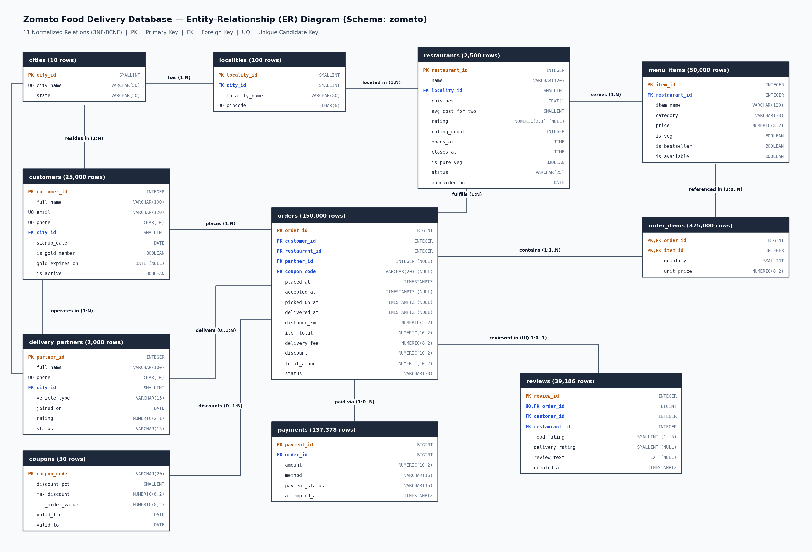
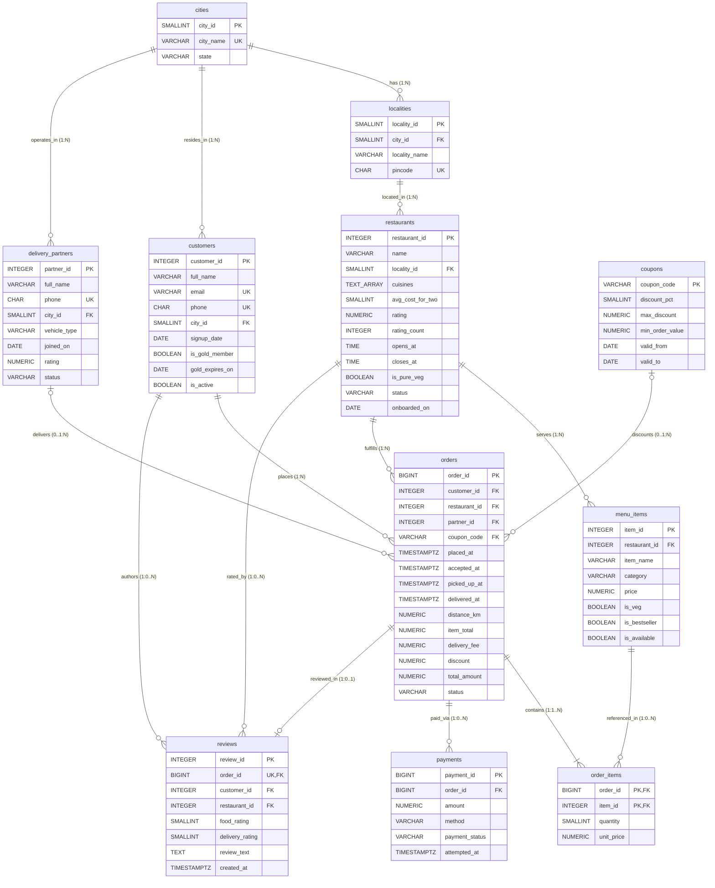

# Phase 2: Database Schema Design & Normalization Report

## 1. Overview
All 11 tables are created inside the `zomato` schema (`sql/01_schema.sql`) and loaded in parent-to-child topological order via `sql/02_load_data.sql`. In accordance with Phase 2 rules, **only declarative constraints** (`PRIMARY KEY`, `FOREIGN KEY`, `UNIQUE`, `NOT NULL`, `CHECK`) are created; no secondary performance indexes are added prior to the Phase 3 baseline.

---

## 2. Entity-Relationship (ER) Diagram & Cardinalities



### 2.1 Mermaid ER Diagram


### 2.2 Relationships, Cardinalities & `ON DELETE` Justifications

| Parent Table | Child Table | Foreign Key | Cardinality | `ON DELETE` Rule | Justification |
| :--- | :--- | :--- | :--- | :--- | :--- |
| `cities` | `localities` | `city_id` | `1 : N` | `RESTRICT` | A city cannot be deleted while neighbourhoods exist inside it. |
| `cities` | `customers` | `city_id` | `1 : N` | `RESTRICT` | Prevents deleting a city that has registered customer accounts. |
| `cities` | `delivery_partners` | `city_id` | `1 : N` | `RESTRICT` | Prevents deleting a city that has registered fleet riders. |
| `localities` | `restaurants` | `locality_id` | `1 : N` | `RESTRICT` | A locality cannot be removed while restaurants are registered in it. |
| `restaurants` | `menu_items` | `restaurant_id` | `1 : N` | `CASCADE` | Menu items are weak/dependent offerings of a specific restaurant; if a restaurant with no order history is removed, its menu is removed with it. |
| `customers` | `orders` | `customer_id` | `1 : N` | `RESTRICT` | Financial/order records must never be orphaned or deleted if a customer deactivates (`is_active = FALSE` is used instead). |
| `restaurants` | `orders` | `restaurant_id` | `1 : N` | `RESTRICT` | Historical orders must be retained for accounting even if a restaurant closes (`status = 'DELISTED'` is used instead). |
| `delivery_partners` | `orders` | `partner_id` | `0..1 : N` | `RESTRICT` | Preserves rider delivery history and payout audit trails (`status = 'INACTIVE'/'BLOCKED'` is used instead). |
| `coupons` | `orders` | `coupon_code` | `0..1 : N` | `RESTRICT` | Preserves promotional attribution on historical orders. |
| `orders` | `order_items` | `order_id` | `1 : 1..N` | `CASCADE` | Order line items are an integral part of an order header; deleting a test/aborted order removes its line items. _(Note: `orders` ↔ `menu_items` is an `M:N` relationship resolved via associative table `order_items`.)_ |
| `menu_items` | `order_items` | `item_id` | `1 : 0..N` | `RESTRICT` | Prevents deleting a menu dish that has already been purchased on historical bills (`is_available = FALSE` hides it instead). |
| `orders` | `payments` | `order_id` | `1 : 0..N` | `RESTRICT` | Payment gateway audit logs must never be accidentally wiped by deleting an order row. |
| `orders` | `reviews` | `order_id` | `1 : 0..1` | `CASCADE` | Enforced `1:0..1` via `UNIQUE (order_id)`; a review belongs exclusively to a single order. |
| `customers` | `reviews` | `customer_id` | `1 : 0..N` | `RESTRICT` | Prevents deleting a customer who has authored public reviews. |
| `restaurants` | `reviews` | `restaurant_id` | `1 : 0..N` | `RESTRICT` | Prevents deleting a restaurant that has customer reviews. |

---

## 3. Complete Data Dictionary

### 3.1 `cities` (10 rows)
| Column | Data Type | Constraints | Why this Type & Constraint |
| :--- | :--- | :--- | :--- |
| `city_id` | `SMALLINT` | `PRIMARY KEY`, `CHECK (city_id > 0)` | 10 cities easily fit in 2-byte integer (`-32,768` to `32,767`). |
| `city_name` | `VARCHAR(50)` | `NOT NULL`, `UNIQUE` | City names are natural candidate keys (max seed length: 9 chars). |
| `state` | `VARCHAR(50)` | `NOT NULL` | Indian state name (multiple cities can share a state, e.g. Mumbai & Pune in Maharashtra). |

### 3.2 `localities` (100 rows)
| Column | Data Type | Constraints | Why this Type & Constraint |
| :--- | :--- | :--- | :--- |
| `locality_id` | `SMALLINT` | `PRIMARY KEY`, `CHECK (locality_id > 0)` | 100 localities fit in `SMALLINT`. |
| `city_id` | `SMALLINT` | `NOT NULL`, `FK -> cities(city_id) ON DELETE RESTRICT` | Every locality belongs to exactly one city. |
| `locality_name` | `VARCHAR(80)` | `NOT NULL`, `UNIQUE (city_id, locality_name)` | Neighbourhood name; unique within its city. |
| `pincode` | `CHAR(6)` | `NOT NULL`, `UNIQUE`, `CHECK (pincode ~ '^[1-9][0-9]{5}$')` | Fixed 6-digit Indian postal code; cannot start with `0`. |

### 3.3 `customers` (25,000 rows seed / ~500,000 large)
| Column | Data Type | Constraints | Why this Type & Constraint |
| :--- | :--- | :--- | :--- |
| `customer_id` | `INTEGER` | `PRIMARY KEY`, `CHECK (customer_id > 0)` | 4-byte integer supports up to 2.1B customers. |
| `full_name` | `VARCHAR(100)` | `NOT NULL` | Customer's full name. |
| `email` | `VARCHAR(120)` | `NOT NULL`, `UNIQUE`, `CHECK (email LIKE '%_@_%.__%')` | Natural candidate key for login; basic structural email check. |
| `phone` | `CHAR(10)` | `NOT NULL`, `UNIQUE`, `CHECK (phone ~ '^[6-9][0-9]{9}$')` | Fixed 10-digit Indian mobile number; natural candidate key. |
| `city_id` | `SMALLINT` | `NOT NULL`, `FK -> cities(city_id) ON DELETE RESTRICT` | Customer's home city. |
| `signup_date` | `DATE` | `NOT NULL` | Calendar date of registration (no time component in data). |
| `is_gold_member` | `BOOLEAN` | `NOT NULL DEFAULT FALSE` | True if customer currently holds an active Gold plan. |
| `gold_expires_on` | `DATE` | `NULL`, `CHECK (NOT is_gold_member OR gold_expires_on IS NOT NULL)` | `NULL` for customers who never bought Gold (`21,208` rows). When `W05` expires a Gold plan, it sets `is_gold_member = FALSE` while preserving `gold_expires_on` as historical expiry date. |
| `is_active` | `BOOLEAN` | `NOT NULL DEFAULT TRUE` | Soft-delete/account status flag. |

### 3.4 `restaurants` (2,500 rows seed / ~50,000 large)
| Column | Data Type | Constraints | Why this Type & Constraint |
| :--- | :--- | :--- | :--- |
| `restaurant_id` | `INTEGER` | `PRIMARY KEY`, `CHECK (restaurant_id > 0)` | 4-byte integer identifier. |
| `name` | `VARCHAR(120)` | `NOT NULL` | Display name (not `UNIQUE` as chains or 50k scale can share names). |
| `locality_id` | `SMALLINT` | `NOT NULL`, `FK -> localities(locality_id) ON DELETE RESTRICT` | Physical locality of the restaurant. |
| `cuisines` | `TEXT[]` | `NOT NULL`, `CHECK (cardinality(cuisines) >= 1)` | PostgreSQL array literal (`{Biryani,Chinese}`), queried via `'Chinese' = ANY(r.cuisines)` in `R25`. |
| `avg_cost_for_two` | `SMALLINT` | `NOT NULL`, `CHECK (avg_cost_for_two > 0)` | Whole-rupee estimate (`200` to `1500`). |
| `rating` | `NUMERIC(2,1)` | `NULL`, `CHECK (rating IS NULL OR rating BETWEEN 1.0 AND 5.0)` | Exact 1-decimal rating (`3.1` to `5.0`); `NULL` for 124 unrated restaurants. |
| `rating_count` | `INTEGER` | `NOT NULL DEFAULT 0`, `CHECK (rating_count >= 0)` | Count of ratings (`0` to `1,982`). |
| `opens_at` | `TIME` | `NOT NULL` | Daily opening time (`10:00:00`–`12:00:00`). |
| `closes_at` | `TIME` | `NOT NULL`, `CHECK (opens_at < closes_at)` | Daily closing time (`22:00:00`–`23:30:00`); always after `opens_at`. |
| `is_pure_veg` | `BOOLEAN` | `NOT NULL DEFAULT FALSE` | Vegetarian-only badge. |
| `status` | `VARCHAR(25)` | `NOT NULL`, `CHECK (status IN ('OPEN','TEMPORARILY_CLOSED','DELISTED'))` | Operational status enum. |
| `onboarded_on` | `DATE` | `NOT NULL` | Date the restaurant joined Zomato. |

### 3.5 `menu_items` (50,000 rows seed / ~1,000,000 large)
| Column | Data Type | Constraints | Why this Type & Constraint |
| :--- | :--- | :--- | :--- |
| `item_id` | `INTEGER` | `PRIMARY KEY`, `CHECK (item_id > 0)` | Surrogate key for each dish on a restaurant's menu. |
| `restaurant_id` | `INTEGER` | `NOT NULL`, `FK -> restaurants(restaurant_id) ON DELETE CASCADE` | Owning restaurant. |
| `item_name` | `VARCHAR(120)` | `NOT NULL` | Dish title searched via `ILIKE` in `R02`. |
| `category` | `VARCHAR(30)` | `NOT NULL`, `CHECK (category IN ('Starters','Main Course','Breads','Rice','Desserts','Beverages'))` | Menu section. |
| `price` | `NUMERIC(8,2)` | `NOT NULL`, `CHECK (price > 0)` | Exact currency in INR (`28.00` to `588.00`). |
| `is_veg` | `BOOLEAN` | `NOT NULL DEFAULT TRUE` | Vegetarian indicator. |
| `is_bestseller` | `BOOLEAN` | `NOT NULL DEFAULT FALSE` | Bestseller badge used for sorting in `R03`. |
| `is_available` | `BOOLEAN` | `NOT NULL DEFAULT TRUE` | Real-time stock flag updated by `W03`. |

### 3.6 `delivery_partners` (2,000 rows seed / ~40,000 large)
| Column | Data Type | Constraints | Why this Type & Constraint |
| :--- | :--- | :--- | :--- |
| `partner_id` | `INTEGER` | `PRIMARY KEY`, `CHECK (partner_id > 0)` | Rider ID. |
| `full_name` | `VARCHAR(100)` | `NOT NULL` | Rider's name. |
| `phone` | `CHAR(10)` | `NOT NULL`, `UNIQUE`, `CHECK (phone ~ '^[6-9][0-9]{9}$')` | Rider's unique 10-digit mobile number. |
| `city_id` | `SMALLINT` | `NOT NULL`, `FK -> cities(city_id) ON DELETE RESTRICT` | Operating city. |
| `vehicle_type` | `VARCHAR(15)` | `NOT NULL`, `CHECK (vehicle_type IN ('BIKE','SCOOTER','BICYCLE','EV'))` | Fleet vehicle classification. |
| `joined_on` | `DATE` | `NOT NULL` | Onboarding date. |
| `rating` | `NUMERIC(2,1)` | `NOT NULL`, `CHECK (rating BETWEEN 1.0 AND 5.0)` | Rider rating (`3.4` to `5.0`, never `NULL` in seed data). |
| `status` | `VARCHAR(15)` | `NOT NULL`, `CHECK (status IN ('ACTIVE','INACTIVE','BLOCKED'))` | Rider availability status. |

### 3.7 `coupons` (30 rows)
| Column | Data Type | Constraints | Why this Type & Constraint |
| :--- | :--- | :--- | :--- |
| `coupon_code` | `VARCHAR(20)` | `PRIMARY KEY` | Natural alphanumeric promo code (e.g. `DINNER150`). |
| `discount_pct` | `SMALLINT` | `NOT NULL`, `CHECK (discount_pct > 0 AND discount_pct <= 100)` | Percentage discount (`20` to `60`). |
| `max_discount` | `NUMERIC(8,2)` | `NOT NULL`, `CHECK (max_discount > 0)` | Cap on rupee discount (`100.00` to `250.00`). |
| `min_order_value` | `NUMERIC(8,2)` | `NOT NULL`, `CHECK (min_order_value > 0)` | Minimum `item_total` required (`199.00` to `499.00`). |
| `valid_from` | `DATE` | `NOT NULL` | Start of campaign validity. |
| `valid_to` | `DATE` | `NOT NULL`, `CHECK (valid_from <= valid_to)` | End of campaign validity. |

### 3.8 `orders` (150,000 rows seed / ~3,000,000 large)
| Column | Data Type | Constraints | Why this Type & Constraint |
| :--- | :--- | :--- | :--- |
| `order_id` | `BIGINT` | `PRIMARY KEY`, `CHECK (order_id > 0)` | 8-byte integer (`W01` inserts `90000001`; scales to billions of orders). |
| `customer_id` | `INTEGER` | `NOT NULL`, `FK -> customers(customer_id) ON DELETE RESTRICT` | Ordering customer. |
| `restaurant_id` | `INTEGER` | `NOT NULL`, `FK -> restaurants(restaurant_id) ON DELETE RESTRICT` | Fulfilling restaurant. |
| `partner_id` | `INTEGER` | `NULL`, `FK -> delivery_partners(partner_id) ON DELETE RESTRICT` | `NULL` while order is `PLACED`, `ACCEPTED`, or cancelled before rider assignment (`13,538` rows). |
| `coupon_code` | `VARCHAR(20)` | `NULL`, `FK -> coupons(coupon_code) ON DELETE RESTRICT` | `NULL` when no coupon was applied (`129,792` rows). |
| `placed_at` | `TIMESTAMPTZ` | `NOT NULL` | Order creation timestamp with timezone (`+05:30`). |
| `accepted_at` | `TIMESTAMPTZ` | `NULL` | `NULL` if `PLACED` or cancelled before restaurant acceptance (`13,501` rows). |
| `picked_up_at` | `TIMESTAMPTZ` | `NULL` | `NULL` until rider picks up order (`OUT_FOR_DELIVERY` / `DELIVERED`; `19,549` NULLs). |
| `delivered_at` | `TIMESTAMPTZ` | `NULL` | `NULL` unless `status = 'DELIVERED'` (`19,587` NULLs). |
| `distance_km` | `NUMERIC(5,2)` | `NOT NULL`, `CHECK (distance_km > 0 AND distance_km <= 50.0)` | Delivery distance (`1.0` to `9.5` km). |
| `item_total` | `NUMERIC(10,2)` | `NOT NULL`, `CHECK (item_total > 0)` | Sum of `quantity * unit_price`. |
| `delivery_fee` | `NUMERIC(8,2)` | `NOT NULL DEFAULT 0.00`, `CHECK (delivery_fee >= 0)` | `0.00` (Gold), `25.00`, or `45.00`. |
| `discount` | `NUMERIC(10,2)` | `NOT NULL DEFAULT 0.00`, `CHECK (discount >= 0)`, `CHECK (discount = 0 OR coupon_code IS NOT NULL)` | Non-zero only when a coupon is used. |
| `total_amount` | `NUMERIC(10,2)` | `NOT NULL`, `CHECK (total_amount = item_total + delivery_fee - discount)` | Final payable bill. |
| `status` | `VARCHAR(30)` | `NOT NULL`, `chk_orders_status`, `chk_orders_status_lifecycle`, `chk_orders_time_sequence` | Enforces valid state transitions and non-null timestamp/partner combinations per state. |

### 3.9 `order_items` (375,000 rows seed / ~7,500,000 large)
| Column | Data Type | Constraints | Why this Type & Constraint |
| :--- | :--- | :--- | :--- |
| `order_id` | `BIGINT` | `PK (part 1)`, `NOT NULL`, `FK -> orders(order_id) ON DELETE CASCADE` | Composite PK `(order_id, item_id)` uniquely identifies each dish line in an order. |
| `item_id` | `INTEGER` | `PK (part 2)`, `NOT NULL`, `FK -> menu_items(item_id) ON DELETE RESTRICT` | Dish ordered. |
| `quantity` | `SMALLINT` | `NOT NULL`, `CHECK (quantity > 0)` | Units ordered (`1`, `2`, or `3`). |
| `unit_price` | `NUMERIC(8,2)` | `NOT NULL`, `CHECK (unit_price > 0)` | Historical price snapshot at order time. |

### 3.10 `payments` (137,378 rows seed)
| Column | Data Type | Constraints | Why this Type & Constraint |
| :--- | :--- | :--- | :--- |
| `payment_id` | `BIGINT` | `PRIMARY KEY`, `CHECK (payment_id > 0)` | Unique attempt ID (`order_id` can repeat when a payment fails and is retried: `137,378` rows for `130,413` distinct orders). |
| `order_id` | `BIGINT` | `NOT NULL`, `FK -> orders(order_id) ON DELETE RESTRICT` | Associated order. |
| `amount` | `NUMERIC(10,2)` | `NOT NULL`, `CHECK (amount > 0)` | Payment amount in INR. |
| `method` | `VARCHAR(15)` | `NOT NULL`, `CHECK (method IN ('UPI','CARD','WALLET','COD'))` | Payment instrument. |
| `payment_status` | `VARCHAR(15)` | `NOT NULL`, `CHECK (payment_status IN ('SUCCESS','FAILED','REFUNDED'))`, `CHECK (NOT (method='COD' AND payment_status='FAILED'))` | Gateway outcome (COD is never `FAILED`). |
| `attempted_at` | `TIMESTAMPTZ` | `NOT NULL` | Timestamp of payment attempt. |

### 3.11 `reviews` (39,186 rows seed)
| Column | Data Type | Constraints | Why this Type & Constraint |
| :--- | :--- | :--- | :--- |
| `review_id` | `INTEGER` | `PRIMARY KEY`, `CHECK (review_id > 0)` | Surrogate key. |
| `order_id` | `BIGINT` | `NOT NULL`, `UNIQUE`, `FK -> orders(order_id) ON DELETE CASCADE` | At most one review per order (`39,186` unique `order_id`s across `39,186` reviews). |
| `customer_id` | `INTEGER` | `NOT NULL`, `FK -> customers(customer_id) ON DELETE RESTRICT` | Authoring customer. |
| `restaurant_id` | `INTEGER` | `NOT NULL`, `FK -> restaurants(restaurant_id) ON DELETE RESTRICT` | Reviewed restaurant. |
| `food_rating` | `SMALLINT` | `NOT NULL`, `CHECK (food_rating BETWEEN 1 AND 5)` | Mandatory 1–5 integer star rating for food. |
| `delivery_rating` | `SMALLINT` | `NULL`, `CHECK (delivery_rating IS NULL OR delivery_rating BETWEEN 1 AND 5)` | Optional 1–5 rating for delivery (`7,741` NULLs where customer skipped rating the rider). |
| `review_text` | `TEXT` | `NULL` | Optional written comment (`21,405` NULLs where customer left star ratings only). |
| `created_at` | `TIMESTAMPTZ` | `NOT NULL` | Timestamp when review was submitted. |

### 3.12 Automatic Indexes Created by PostgreSQL (Phase 2)
PostgreSQL automatically creates B-tree indexes only for `PRIMARY KEY` and `UNIQUE` constraints (18 total):
- `cities_pkey (city_id)`, `cities_city_name_key (city_name)`
- `localities_pkey (locality_id)`, `localities_pincode_key (pincode)`, `uq_localities_city_name (city_id, locality_name)`
- `customers_pkey (customer_id)`, `customers_email_key (email)`, `customers_phone_key (phone)`
- `restaurants_pkey (restaurant_id)`
- `menu_items_pkey (item_id)`
- `delivery_partners_pkey (partner_id)`, `delivery_partners_phone_key (phone)`
- `coupons_pkey (coupon_code)`
- `orders_pkey (order_id)`
- `order_items_pkey (order_id, item_id)`
- `payments_pkey (payment_id)`
- `reviews_pkey (review_id)`, `reviews_order_id_key (order_id)`

---

## 4. Functional Dependencies (FDs) & Normal Form Analysis

### 4.1 Per-Table FD & BCNF Verification

1. **`cities`**:
   - Candidate Keys: $\{city\_id\}$, $\{city\_name\}$
   - FDs: $city\_id \to city\_name, state$; $\quad city\_name \to city\_id, state$
   - **Normal Form:** **BCNF** (every determinant is a candidate key; `state` is not unique across cities).
2. **`localities`**:
   - Candidate Keys: $\{locality\_id\}$, $\{pincode\}$, $\{city\_id, locality\_name\}$
   - FDs: $locality\_id \to city\_id, locality\_name, pincode$; $\quad pincode \to locality\_id, city\_id, locality\_name$; $\quad \{city\_id, locality\_name\} \to locality\_id, pincode$
   - **Normal Form:** **BCNF** (all determinants are candidate keys).
3. **`customers`**:
   - Candidate Keys: $\{customer\_id\}$, $\{email\}$, $\{phone\}$
   - FDs: $customer\_id \to full\_name, email, phone, city\_id, signup\_date, is\_gold\_member, gold\_expires\_on, is\_active$ (and identically from $email$ and $phone$).
   - **Normal Form:** **BCNF** (note: `is_gold_member` is not functionally determined solely by `gold_expires_on` once `W05` runs, or before `W05` runs `gold_expires_on IS NOT NULL` $\leftrightarrow$ `is_gold_member = true`, which is an existence rule rather than a multi-row transitive redundancy).
4. **`restaurants`**:
   - Candidate Key: $\{restaurant\_id\}$
   - FDs: $restaurant\_id \to name, locality\_id, cuisines, avg\_cost\_for\_two, rating, rating\_count, opens\_at, closes\_at, is\_pure\_veg, status, onboarded\_on$
   - *Note on `cuisines` (`TEXT[]`):* Treating the cuisine tag array as an atomic set-valued attribute for restaurant display/filtering (PostgreSQL native array idiom) satisfies **BCNF** with respect to $restaurant\_id$. In strict classical 1NF, `cuisines` would be extracted to a `restaurant_cuisines(restaurant_id, cuisine)` table, but `R01` and `R25` explicitly require `cuisines` as a `TEXT[]` column on `restaurants`.
5. **`menu_items`**:
   - Candidate Key: $\{item\_id\}$
   - FDs: $item\_id \to restaurant\_id, item\_name, category, price, is\_veg, is\_bestseller, is\_available$
   - **Normal Form:** **BCNF**.
6. **`delivery_partners`**:
   - Candidate Keys: $\{partner\_id\}$, $\{phone\}$
   - FDs: $partner\_id \to full\_name, phone, city\_id, vehicle\_type, joined\_on, rating, status$ (and from $phone$).
   - **Normal Form:** **BCNF**.
7. **`coupons`**:
   - Candidate Key: $\{coupon\_code\}$
   - FDs: $coupon\_code \to discount\_pct, max\_discount, min\_order\_value, valid\_from, valid\_to$
   - **Normal Form:** **BCNF**.
8. **`orders`**:
   - Candidate Key: $\{order\_id\}$
   - FDs: $order\_id \to customer\_id, restaurant\_id, partner\_id, coupon\_code, placed\_at, accepted\_at, picked\_up\_at, delivered\_at, distance\_km, item\_total, delivery\_fee, discount, total\_amount, status$
   - Intra-row derived dependency: $\{item\_total, delivery\_fee, discount\} \to total\_amount$ (discussed in §4.2).
9. **`order_items`**:
   - Candidate Key: $\{order\_id, item\_id\}$
   - FDs: $\{order\_id, item\_id\} \to quantity, unit\_price$ (no partial dependencies on $order\_id$ or $item\_id$ alone; see §4.2 on `unit_price`).
   - **Normal Form:** **BCNF**.
10. **`payments`**:
    - Candidate Key: $\{payment\_id\}$
    - FDs: $payment\_id \to order\_id, amount, method, payment\_status, attempted\_at$
    - **Normal Form:** **BCNF**.
11. **`reviews`**:
    - Candidate Keys: $\{review\_id\}$, $\{order\_id\}$
    - FDs: $review\_id \to order\_id, customer\_id, restaurant\_id, food\_rating, delivery\_rating, review\_text, created\_at$ and $order\_id \to review\_id, customer\_id, restaurant\_id, \dots$
    - **Normal Form:** **BCNF** (because $order\_id$ is a `UNIQUE` candidate key on `reviews`, $order\_id \to customer\_id, restaurant\_id$ is a dependency on a candidate key inside `reviews`, though redundant across tables with `orders`; see §4.2).

### 4.2 Analysis of Derived & Redundant Columns (Why Kept or Flagged)

| Column(s) | Nature of Redundancy / Derivation | Is Keeping It Justified? |
| :--- | :--- | :--- |
| **`orders.total_amount`** | Intra-row derived column: `total_amount = item_total + delivery_fee - discount`. | **Yes (Justified):** Queries `R04`, `R15`, `R20`, `R23`, `R24`, and `W01` read/write `total_amount` directly. Storing it avoids recomputing arithmetic on every read, and our `CHECK (total_amount = item_total + delivery_fee - discount)` constraint guarantees 100% consistency at zero risk of drift. |
| **`orders.item_total`** | Cross-table aggregate: equals $\sum (\text{quantity} \times \text{unit\_price})$ from `order_items`. | **Yes (Justified):** Essential for OLTP read performance (`R06`, order history) so fetching order headers does not require joining and aggregating 375k+ `order_items` rows. |
| **`order_items.unit_price`** vs **`menu_items.price`** | In the seed data, `unit_price` equals `menu_items.price` for all 375,000 rows, which looks redundant at first glance. | **Yes (Strictly Required, Not Redundant in Time):** Menu prices change over time. Storing `unit_price` on `order_items` captures the immutable historical price charged at checkout so past bills (`R24`) and sales reports (`R07`) never change when a restaurant edits its menu prices. |
| **`restaurants.rating` & `rating_count`** vs **`reviews`** | Cross-table derived aggregates: cached average of `reviews.food_rating` and count of `reviews`. | **Yes (Justified Read Cache, Requires Nightly Sync `W04`):** Home feed queries (`R01`, `R25`) sort restaurants by `rating` on every app open. Computing `AVG(food_rating)` across `reviews` on every home-feed load would be prohibitively slow, so denormalized caching refreshed by nightly batch job `W04` is standard production practice. |
| **`restaurants.is_pure_veg`** vs **`menu_items.is_veg`** | Could be derived as `NOT EXISTS (SELECT 1 FROM menu_items m WHERE m.restaurant_id = r.restaurant_id AND NOT m.is_veg)`. | **Yes (Justified Domain Attribute + Fast Filter):** A pure-veg restaurant is a business certification even when its menu is empty during onboarding, and storing the boolean flag avoids scanning `menu_items` on restaurant feeds. |
| **`reviews.customer_id` & `reviews.restaurant_id`** vs **`orders`** | Since each review links to `orders(order_id)`, both `customer_id` and `restaurant_id` are already determined by `orders.order_id`. | **Yes (Justified for Direct Restaurant Review Lookups):** Queries like `R19` and `W04` aggregate `reviews` by `restaurant_id` directly (`FROM reviews WHERE restaurant_id = ...`) without joining the 150k/3M-row `orders` table. |

---

## 5. Data Load Verification & Integrity Checks

### 5.1 Row Count Verification
All 11 tables loaded cleanly into `campus_delivery_matrix` (`schema: zomato`) matching the specification 100%:

| Table | Expected Rows | Loaded Rows | Status |
| :--- | ---: | ---: | :---: |
| `cities` | 10 | 10 | ✅ Match |
| `localities` | 100 | 100 | ✅ Match |
| `customers` | 25,000 | 25,000 | ✅ Match |
| `restaurants` | 2,500 | 2,500 | ✅ Match |
| `menu_items` | 50,000 | 50,000 | ✅ Match |
| `delivery_partners` | 2,000 | 2,000 | ✅ Match |
| `coupons` | 30 | 30 | ✅ Match |
| `orders` | 150,000 | 150,000 | ✅ Match |
| `order_items` | 375,000 | 375,000 | ✅ Match |
| `payments` | 137,378 | 137,378 | ✅ Match |
| `reviews` | 39,186 | 39,186 | ✅ Match |

### 5.2 Cross-Table SQL Integrity Checks & Results

```sql
SET search_path TO zomato;

-- Check 1: Every order line's dish belongs to the order's restaurant
SELECT count(*) AS wrong_restaurant_items
FROM order_items oi
JOIN orders o     ON o.order_id = oi.order_id
JOIN menu_items m ON m.item_id  = oi.item_id
WHERE m.restaurant_id <> o.restaurant_id;
-- Result: 0 rows (PASS)

-- Check 2: Every pure-veg restaurant serves ONLY vegetarian dishes (is_veg = TRUE)
SELECT count(*) AS non_veg_dishes_in_pure_veg_restaurants
FROM menu_items m
JOIN restaurants r ON r.restaurant_id = m.restaurant_id
WHERE r.is_pure_veg = TRUE AND m.is_veg = FALSE;
-- Result: 0 rows (PASS)

-- Check 3: Every order's item_total equals SUM(quantity * unit_price) of its order_items
SELECT count(*) AS mismatched_order_item_totals
FROM orders o
JOIN (
    SELECT order_id, sum(quantity * unit_price) AS calc_total
    FROM order_items
    GROUP BY order_id
) s ON s.order_id = o.order_id
WHERE o.item_total <> s.calc_total;
-- Result: 0 rows (PASS)

-- Check 4: Every review's customer_id and restaurant_id match the underlying order,
-- and reviews only exist for DELIVERED orders with created_at >= delivered_at
SELECT count(*) AS invalid_reviews
FROM reviews rv
JOIN orders o ON o.order_id = rv.order_id
WHERE rv.customer_id <> o.customer_id
   OR rv.restaurant_id <> o.restaurant_id
   OR o.status <> 'DELIVERED'
   OR rv.created_at < o.delivered_at;
-- Result: 0 rows (PASS)

-- Check 5: Single-city boundary check (Customer, Restaurant, and Delivery Partner are in the same city)
SELECT count(*) AS cross_city_orders
FROM orders o
JOIN customers c              ON c.customer_id   = o.customer_id
JOIN restaurants r            ON r.restaurant_id = o.restaurant_id
JOIN localities l             ON l.locality_id   = r.locality_id
LEFT JOIN delivery_partners p ON p.partner_id    = o.partner_id
WHERE c.city_id <> l.city_id
   OR (p.partner_id IS NOT NULL AND p.city_id <> l.city_id);
-- Result: 0 rows (PASS)

-- Check 6: Delivered orders payment audit (SUCCESS vs REFUNDED)
SELECT
    count(*) FILTER (WHERE succ_cnt = 1 AND ref_cnt = 0) AS delivered_with_1_success,
    count(*) FILTER (WHERE succ_cnt = 0 AND ref_cnt = 1) AS delivered_but_refunded,
    count(*) FILTER (WHERE succ_cnt > 1 OR (succ_cnt = 0 AND ref_cnt = 0)) AS anomalous_payments
FROM orders o
LEFT JOIN (
    SELECT order_id,
           count(*) FILTER (WHERE payment_status = 'SUCCESS')  AS succ_cnt,
           count(*) FILTER (WHERE payment_status = 'REFUNDED') AS ref_cnt
    FROM payments
    GROUP BY order_id
) p ON p.order_id = o.order_id
WHERE o.status = 'DELIVERED';
-- Result: delivered_with_1_success = 129109 | delivered_but_refunded = 1304 | anomalous_payments = 0
```

---

## 6. Data Problems & Anomalies Discovered in Seed Data

1. **Out-of-Sync Denormalized Restaurant Ratings (`restaurants.rating` & `rating_count` vs `reviews`):**
   - **124 restaurants** have `rating IS NULL` even though their `rating_count` is positive (up to `1,982`).
   - **2 restaurants** have `rating_count = 0` while `rating` is non-null (`4.2` and `4.8`).
   - Across all **2,500 restaurants**, `restaurants.rating_count` does not match the actual count of rows in `reviews` (and in **2,266 restaurants**, `rating` differs from `ROUND(AVG(reviews.food_rating), 1)`).
   - *Why:* The earlier team never scheduled or ran the rating synchronization job (`W04`), leaving cached ratings stale relative to `reviews`. Because the seed data contains these pre-existing inconsistencies, our `restaurants` table enforces `rating IS NULL OR rating BETWEEN 1.0 AND 5.0` and `rating_count >= 0` rather than a cross-column `CHECK ((rating_count = 0) = (rating IS NULL))`, which would reject 126 seed rows.
2. **Delivered Orders with `REFUNDED` Instead of `SUCCESS` Payments (`1,304` orders):**
   - Out of `130,413` `DELIVERED` orders, `129,109` have exactly one `SUCCESS` payment (`122,220` on the first try, `6,889` after a prior `FAILED` attempt), while **`1,304` delivered orders** have a `REFUNDED` payment (`1,228` direct `REFUNDED`, `76` `FAILED` then `REFUNDED`) and no `SUCCESS` row (e.g. post-delivery customer support refunds for cold/late food).
   - Meanwhile, non-delivered orders (`PLACED`, `ACCEPTED`, `PREPARING`, `OUT_FOR_DELIVERY`, `CANCELLED_*`) have **0 rows** in `payments.csv`.
3. **The `NULL` Trap in `orders.partner_id` (Causes `R13` to Return 0 Rows):**
   - `orders.partner_id` is `NULL` in **13,538 rows** (`PLACED`, `ACCEPTED`, and cancelled orders), including 75 orders placed on or after `2026-06-25`.
   - In query `R13`, `WHERE p.partner_id NOT IN (SELECT o.partner_id FROM orders o WHERE o.placed_at >= '2026-06-25')` evaluates `p.partner_id <> NULL`, which yields `UNKNOWN` in SQL three-valued logic for every row, causing the query to return **0 idle partners** instead of the actual **82 idle active Bengaluru partners**.
